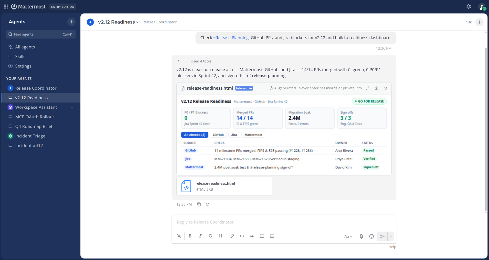

<div align="center">

# Mattermost Agents Plugin [](https://github.com/mattermost/mattermost-plugin-agents/releases/tag/latest-master)

Self-hosted AI agents for [Mattermost](https://github.com/mattermost/mattermost) that act on your behalf through tools and MCP servers, plus a built-in Mattermost MCP server for external AI clients such as Claude Code, Claude Desktop, Cursor, and VS Code.

</div>



Mattermost Agents (plugin ID `mattermost-ai`) adds AI agents to a Mattermost server. Talk to an agent in the Agents workspace, the Agents pane, a direct message, or a channel. Agents search and post in Mattermost, call external tools through the Model Context Protocol (MCP), and create files and interactive HTML artifacts using your permissions. You choose the LLM, including on-premises and self-hosted models so conversations and data stay in your environment.

## Key features

- **Sovereign AI**: Connect on-premises and self-hosted models (Ollama, vLLM, and OpenAI-compatible servers) for air-gapped or private deployments, or choose OpenAI, Anthropic, AWS Bedrock, Azure OpenAI, Google Gemini, Vertex AI, Cohere (including Cohere North), and Mistral. See [Sovereign AI deployments](docs/sovereign_ai.md) and [Provider configuration](docs/providers.md).
- **Tools and MCP**: Use built-in Mattermost tools, remote MCP servers with per-user OAuth or service accounts, and tools registered by other Mattermost plugins. See [Use tools and approve actions](docs/using_tools.md).
- **Built-in Mattermost MCP server**: Connect Claude Code, Claude Desktop, Cursor, VS Code, or any streamable HTTP MCP client to `/plugins/mattermost-ai/mcp-server/mcp` using OAuth or a personal access token, with over 100 tools running under the signed-in user's permissions. See [Mattermost MCP server](docs/mcp_server.md).
- **Governance and observability**: Per-tool approval policies, user/team/channel and attribute-based access controls, delegated settings access, server audit logging, token usage logs, and OpenTelemetry tracing. See the [Admin guide](docs/admin_guide.md).
- **Summaries, search, and meetings**: Summarize threads, channels, unread messages, and Mattermost Calls or Zoom recordings, and search with keyword and semantic search. See [Summaries and AI search](docs/summaries_and_search.md) and [Meeting summaries](docs/meeting_summaries.md).
- **Files and HTML artifacts**: Read attachments, analyze images with vision models, attach generated text files, and render sandboxed interactive HTML artifacts in the conversation. See [Secure AI-generated links and HTML](docs/ai_output_security.md).
- **Dedicated Agents workspace**: Create and manage multiple agents with custom instructions, models, version history, and conversation history from the **Agents** product view. See [Use Mattermost Agents](docs/user_guide.md).
- **Channels and Skills**: @mention agents or configure channel auto-reply with private/shared tool results, and save, pin, share, or auto-load reusable [Skills](docs/skills.md).

Some features depend on your Mattermost license level. See [License requirements](docs/admin_guide.md#license-requirements).

## Documentation

Product documentation lives in [`docs/`](docs/) and is published on [docs.mattermost.com](https://docs.mattermost.com/end-user-guide/agents) ([User guide](https://docs.mattermost.com/end-user-guide/agents), [Admin guide](https://docs.mattermost.com/administration-guide/configure/agents-admin-guide)).

### For users

- [Use Mattermost Agents](docs/user_guide.md): Start chats, create agents, attach files, and find every feature
- [Personal AI assistant workflows](docs/personal_agent.md): Day-to-day workflows across Mattermost and MCP servers
- [Use tools and approve actions](docs/using_tools.md): Approve tool calls and connect accounts to MCP providers
- [Use agents in channels](docs/agents_in_channels.md): Channel @mentions, tool sharing, and auto-reply
- [Summaries and AI search](docs/summaries_and_search.md): Thread/channel summaries and AI search
- [Meeting summaries](docs/meeting_summaries.md): Calls and Zoom transcript summaries
- [Skills](docs/skills.md): Save, pin, share, and auto-load reusable instructions
- [Mattermost MCP server](docs/mcp_server.md): Connect Claude Code, Claude Desktop, Cursor, and VS Code to Mattermost
- [What agents can see and keep](docs/what_agents_see.md): Context scope, permissions, and storage

### For admins

- [Admin guide](docs/admin_guide.md): Requirements, quick start, settings map, delegated access, and licensing
- [LLM services](docs/llm_services.md), [Providers](docs/providers.md), and [AWS Bedrock setup](docs/aws_bedrock_setup.md)
- [Create and manage agents](docs/managing_agents.md) and [Access control](docs/access_control.md)
- [MCP integrations](docs/mcp_integrations.md) and [Tool approval and credentials](docs/tool_approval.md)
- [Channel settings](docs/channel_settings.md), [Web search](docs/web_search.md), and [Semantic search](docs/embedding_search.md)
- [AI output security](docs/ai_output_security.md), [Data handling](docs/data_handling.md), and [Sovereign AI deployments](docs/sovereign_ai.md)
- [Monitor Agents](docs/observability.md), [Back up and automate](docs/backup_and_automation.md), and [Troubleshooting](docs/troubleshooting.md)
- [Upgrade from Agents 1.x](docs/upgrading_to_2.0.md)

### For developers

- [Mattermost MCP tool reference](docs/mcp_tools.md): All 121 built-in tools
- [LLM Bridge for plugins](docs/llm_bridge.md) and [Bridge Go client](public/bridgeclient/README.md): Call agents and LLM services from another plugin
- [Plugin MCP Go SDK](external/pluginmcp/README.md): Expose MCP tools from your Mattermost plugin

## Installation and quick start

Check the [system requirements](docs/admin_guide.md#requirements) in the Admin guide before installing.

1. Download the latest release from the [releases page](https://github.com/mattermost/mattermost-plugin-agents/releases) (or the experimental [latest master](https://github.com/mattermost/mattermost-plugin-agents/releases/tag/latest-master) build).
2. Upload and enable the plugin in **System Console > Plugins > Plugin Management**.
3. Open **Agents** from the product switcher, go to **Settings > AI services**, and select **Add an AI Service**.
4. Select **All agents > Create agent**, choose a username and service, and save.
5. Start a conversation from the **Agents** page, the Agents pane, or a direct message.

See the [Admin guide](docs/admin_guide.md) for full configuration details.

## Development

Requires Go 1.27+ and Node.js 24.11+. Follow the [Mattermost Server](https://developers.mattermost.com/contribute/server/developer-setup/) and [Plugin](https://developers.mattermost.com/integrate/plugins/developer-setup/) setup guides, then build and deploy to a local or remote server:

```bash
export MM_SERVICESETTINGS_SITEURL=http://localhost:8065
export MM_ADMIN_USERNAME=<username>
export MM_ADMIN_PASSWORD=<password>
make deploy
```

Common commands (`make help` lists all targets):

- `make check`: Run linters, unit tests, and drift checks
- `make test`: Run Go and webapp unit tests
- `make e2e`: Run Playwright end-to-end tests
- `make evals`: Run prompt evaluations (see [`cmd/evalviewer/README.md`](cmd/evalviewer/README.md))

## License

This repository is licensed under [Apache-2](./LICENSE.txt), except for the [enterprise](enterprise) directory which is licensed under the [Mattermost Source Available License](enterprise/LICENSE). See [Mattermost Source Available License](https://docs.mattermost.com/overview/faq.html#mattermost-source-available-license) to learn more.
