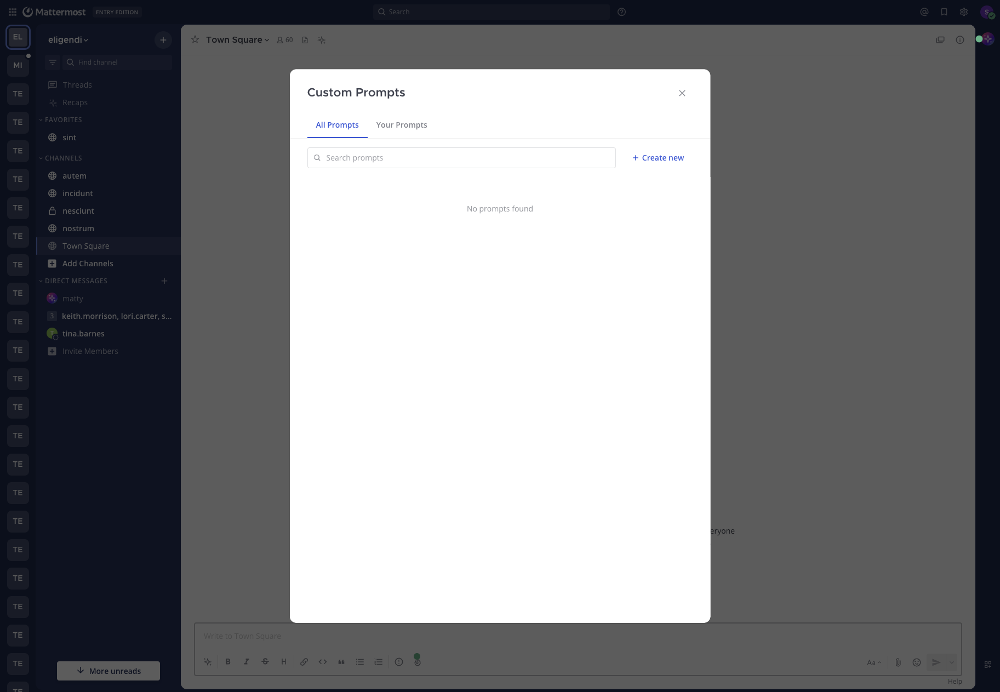

# Custom prompts

Save prompt templates with variables like `{{.ChannelName}}`, run them from the composer or a pinned button, and share them with your workspace. Personal prompts work at every license level, and sharing needs Enterprise.

## Create a prompt

1. In any message composer, open **AI Actions** and select **Custom prompts**, then **Manage prompts**.
2. Select **Create new**.
3. Fill in the fields:

   | Field | Notes |
   |---|---|
   | **Action Title** | Required. Up to 64 characters. Appears in menus and on pinned buttons. |
   | **Brief Description** | Optional. Helps you and others remember what the prompt is for. |
   | **System Prompt** | Required. The message template Mattermost sends when the prompt runs. Write it as you would write a message to the agent. |
   | **Visibility** | **Private** (only you) or **Public** (everyone in the workspace). Private is the default. |

4. Select **Save**.



Use the **Context Variables** button above the **System Prompt** field to insert variables. Public prompts need an Enterprise license. Switching a public prompt back to private is always allowed.

## Template variables

Templates use Go `text/template` syntax. These are the only variables available:

| Variable | Inserts |
|---|---|
| `{{.Username}}` | Your username |
| `{{.FirstName}}` | Your first name |
| `{{.LastName}}` | Your last name |
| `{{.Channel}}` | The current channel's display name |
| `{{.ChannelName}}` | The current channel's name |
| `{{.Team}}` | The current team's display name |
| `{{.TeamName}}` | The current team's name |
| `{{.Time}}` | The current UTC time |
| `{{.BotName}}` | The selected agent's display name |

A variable with no value in the current context, such as `{{.Team}}` in a direct message, renders as empty text. `{{.BotName}}` is filled in when you run a prompt from the composer, and is empty when you run it from a pinned button.

Variables that include `{{.Channel}}` or `{{.ChannelName}}` tell the agent which channel you're in. They don't pull in the channel's messages. To catch up on a channel, use [Summaries and AI search](summaries_and_search.md).

## Run a prompt

**From the composer.** Open **AI Actions**, select **Custom prompts**, choose an agent at the top of the menu if you have several, and select the prompt. Mattermost renders the template with your current context and puts the result in your draft. If you aren't in a direct message with an agent, it adds the agent's @mention first. Edit the draft if you want, then send it. Files already attached to the draft stay attached.

**From a pinned button.** Open the Agents pane, start a new chat, choose an agent, and select a pinned prompt. Mattermost renders the template and sends it immediately, with no chance to edit. Use the composer if you want to review first.

The agent responds as it would to any message, with the same tool approval and connection prompts. A prompt doesn't change how the agent behaves.

## Share, pin, and manage prompts

In the **Custom Prompts** window:

- **All Prompts** shows your prompts and public prompts from others. **Your Prompts** shows only yours.
- Search filters by title and description.
- The pin icon pins a prompt to your Agents pane. Pins are personal. You can pin a public prompt someone else wrote without affecting anyone else.
- A public prompt from someone else opens read-only. Only the creator can edit or delete a prompt. To change someone else's prompt, copy its template into a new prompt.
- Deleting a prompt removes it from everyone's lists and pins.

## Examples

**Incident triage**, title `Triage this channel`:

```text
You are helping me triage an active incident in #{{.ChannelName}} on the {{.Team}} team. As of {{.Time}}, list:

1. The current status in one sentence.
2. The top 3 unresolved questions.
3. Suggested next steps and who is best placed to take them.
```

**Runbook**, title `Run the on-call playbook`:

```text
I'm {{.FirstName}} ({{.Username}}) and I'm on call. Walk me through our "service is degraded" playbook one step at a time. Wait for me to confirm each step. If you need a tool to check service state, ask first.
```

**Code review**, title `Review checklist`:

```text
Apply our review checklist to the diff I paste next: naming, error handling, test coverage of the new behavior, backward-compatibility risk, and anything that belongs in a separate PR. Reply with bullets, not prose.
```

## Limits

- Titles are limited to 64 characters. There's no set limit on template length, but very long templates leave less room for the agent's answer.
- The agent is chosen when you run the prompt. After a composer prompt is inserted, the @mention is already in your draft, so edit it by hand to change agents.
