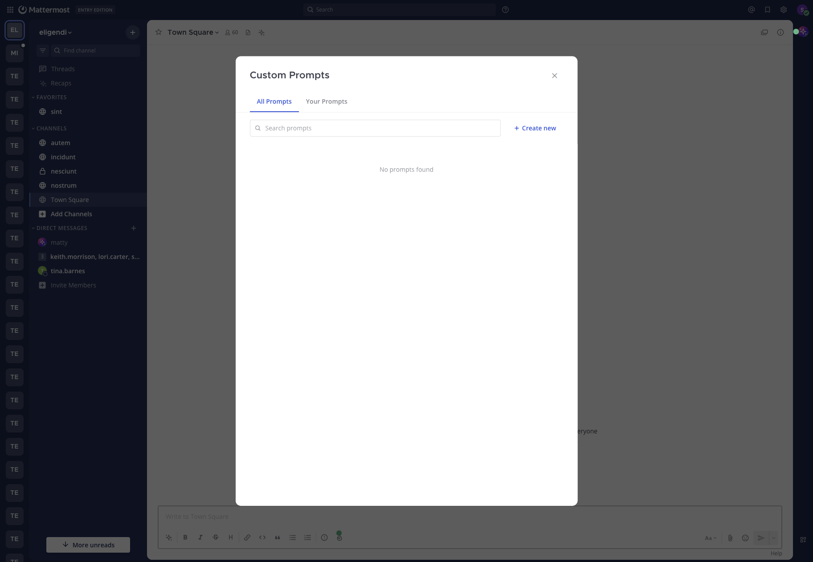

<!--
Copyright (c) 2023-present Mattermost, Inc. All Rights Reserved.
See LICENSE.txt for license information.
-->

# Skills

Skills are saved instructions you can reuse from the message composer or as shortcut buttons in the **Agents** pane. Use them to capture team workflows — incident triage, document review, runbook execution, code review checklists, status updates — once, then run them anywhere with the agent of your choice. Agents can also load a skill on their own when a request matches its description; see [How agents use skills](#how-agents-use-skills).

Skills were previously called Custom Prompts. Existing custom prompts are now skills; nothing needs to be migrated.

Each skill has a title, a description, instructions (the text that gets sent, or loaded by the agent), and a visibility setting that determines whether other users in the workspace can use it. You can pin skills so they appear as one-click buttons in the **Agents** pane.

## How agents use skills

Besides running a skill yourself, an agent can load a skill on its own. When a conversation starts, the agent is told the name and description of each skill it may use. When a request matches a description, the agent loads that skill's instructions and follows them. Only the descriptions are sent up front, so a skill costs almost nothing until it is used.

Which skills an agent may load is set on the agent's [Skills tab](managing_agents.md#skills-tab):

- **Skills built into Agents** are always available while the tools they need are. For example, the agent can load channel and thread summary instructions, including citation links to the posts it used, whenever it can read channels.
- **Your personal skills** are available in your direct messages with the agent when the agent allows personal skills. They are never used in channels.
- **Shared skills** are available only after they are turned on for that agent.

The agent only sees a skill's description, so write it to say when the skill applies — for example, "Use when the user asks for an incident status update." A skill without a description is never loaded automatically. Descriptions are limited to 1024 characters.

The list of skills is fixed when a conversation starts. If you create or change a skill during a conversation, tell the agent; it can refresh the list. Agents can't load a skill you no longer have access to, even if it was listed when the conversation started.

## What replaced the old prompt buttons

In Mattermost Agents v1, the **Agents** pane shipped with a fixed set of starter buttons such as **Brainstorm ideas**, **Meeting agenda**, **To-do list**, and **Pros and Cons**. Selecting one of those buttons inserted a hard-coded phrase into the composer. Those buttons were removed earlier in the v2 development cycle and Skills (then called Custom Prompts) replaced that pattern with a more durable system: instead of a fixed list, you and your teammates create your own skills, share them across the workspace, and pin the ones you use most.

If you used the v1 starter buttons, recreate the ones you relied on as skills and pin them. The pinned skills appear in the same area of the **Agents** pane where the old buttons used to live.

## Create a skill

To create a skill:

1. Open the message composer in any channel or direct message.
2. Select **AI Actions**.
3. Open **Skills**, then select **Manage skills**.
4. Select **Create new** to open the skill editor.
5. Set the **Visibility** to **Public** to share the skill with other users in the workspace, or **Private** to keep it visible only to you.

   Personal (private) skills are available at every license level. Publishing a skill as **Public**, and discovering or using skills published by others, is available at Enterprise and above (see [license requirements](../admin_guide.md#license-requirements)). Switching a public skill back to private is always permitted.
6. Enter an **Action Title**. The title is required and can be up to 64 characters. It's the label that appears in menus and on pinned buttons.
7. Enter a **Brief Description** that says when the skill applies. Agents use it to decide whether to load the skill, so a skill without one is only run by hand. Descriptions can be up to 1024 characters.
8. Enter the **Instructions**. This is the text that gets rendered and sent on your behalf when you run the skill, or loaded by the agent. The instructions are required.
9. Select **Save**.

You can use the **Context Variables** button above the instructions field to insert variables that get filled in with values from your current context (your username, the current channel, the current team, the time, and so on). See [Template variables](#template-variables) below for the full list.

## Share, pin, and manage skills

Skills are managed from the **Skills** modal:

- The **All Skills** tab shows skills you created plus public skills shared by other users.
- The **Your Skills** tab shows only the skills you created.
- Use the search box at the top of the modal to filter skills by title or description.
- Select the pin icon on any row to pin or unpin a skill for yourself. Pinning is per-user — you can pin your own skills or any public skill shared by another user. Pinned skills appear as one-click buttons at the top of a new chat in the **Agents** pane.
- Select a skill row to open a dedicated view inside the modal. Use the back arrow in the header to return to the list.

### Visibility and ownership

| Setting | Who can use it | Who can edit or delete it |
|---------|----------------|---------------------------|
| **Public** | Anyone in the workspace | Only the creator |
| **Private** | Only the creator | Only the creator |

When you open a public skill that someone else created, it opens read-only — you can read the instructions, but the **Save** and **Delete** controls aren't shown. To pin it, go back to the list and select the pin icon on the skill row. Only the skill's creator can change its title, description, instructions, or visibility, or delete it.

## Run a skill yourself

There are two ways to run a saved skill yourself.

### From the message composer

1. Open the message composer in any channel, thread, or direct message.
2. Select **AI Actions**, then **Skills**.
3. If multiple agents are configured for your workspace, choose the agent you want to use from the agent selector at the top of the menu.
4. Select the skill you want to run.

Mattermost renders the instructions with your current context (channel, team, user, time, selected agent) and inserts the result into your draft. If you're not in a direct message with a bot, Mattermost also prepends the selected agent's `@mention` so the agent will respond in-thread when you post.

You can review and edit the rendered draft before sending it like any other message.



### From a pinned button in the Agents pane

1. Open the **Agents** pane and start a new chat.
2. Select the agent you want to use.
3. Select a pinned skill button.

Pinned-skill buttons render the instructions against your current context and post the rendered message immediately, then switch you into the resulting thread so you can read the agent's response. Use this when you want a faster path than opening the **Skills** menu and confirming the draft.

> **Note:** Pinned-skill buttons send the rendered message right away — there's no review step before posting. Use the composer flow if you want to edit the rendered text before sending.

## Template variables

Skill instructions support the variables below, both when you run a skill and when an agent loads it. Variables use Go `text/template` syntax — `{{.Username}}`, `{{.Time}}`, and so on. The **Context Variables** dropdown in the editor inserts them at the cursor.

| Variable | Inserts |
|----------|---------|
| `{{.Username}}` | Your Mattermost username |
| `{{.FirstName}}` | Your first name |
| `{{.LastName}}` | Your last name |
| `{{.Channel}}` | The current channel display name |
| `{{.ChannelName}}` | The current channel name |
| `{{.Team}}` | The current team display name |
| `{{.TeamName}}` | The current team name |
| `{{.Time}}` | The current UTC time |
| `{{.BotName}}` | The selected agent's display name, when available |

If a value isn't available in the current context — for example, `{{.Team}}` when you're in a direct message that isn't tied to a team — Mattermost renders the variable as empty text. The rest of the instructions still render normally.

`{{.BotName}}` is populated in the composer flow (where an agent is selected in the **Skills** menu) and when an agent loads a skill, but is empty when a skill is run from a pinned button in the **Agents** pane.

## Compose with other Agents features

When you run a skill yourself, it drafts and sends a message — it doesn't change how the agent behaves once it receives that message. After your skill is rendered and posted, the response uses the same Agents capabilities as any other conversation:

- **Agent selection.** The skill runs against whichever agent is selected in the **Skills** menu (composer flow) or the **Agents** pane (pinned-button flow). Switching agents lets you run the same skill against different models or system instructions.
- **Channel context and summaries.** Skills that include `{{.Channel}}` or `{{.ChannelName}}` give the agent the channel where you ran the skill, but they don't automatically pull recent channel history. For "what happened in this channel" workflows, use [Channel Summaries](channel_summaries.md) — the **Ask Agents about this channel** entry point is purpose-built for that.
- **Tool calling.** Agent responses to a skill go through the same tool approval flow as any other agent response. In direct messages, tool results are shared automatically with you. In channels (when your system admin has enabled channel-mention tool calling), only the person who ran the skill can approve or reject pending tools, and the standard **Share** / **Keep Private** controls apply to tool results. See the **Use tools** section of the [user guide](../user_guide.md#use-tools).
- **MCP and external tools.** Skills don't bypass tool approval policies or MCP provider connection state — if the agent needs an MCP tool that you haven't connected yet, you'll see the same prompts you would in any other conversation.
- **File attachments.** Running a skill from the composer updates the draft text but preserves any files already attached to the post.

## Examples

The instructions are the message that gets sent on your behalf, so write it as you would write a message to the agent. The examples below show common team workflows.

### Incident triage

Title: `Triage this channel`

```
You are helping me triage an active incident in the #{{.ChannelName}} channel on the {{.Team}} team. As of {{.Time}}, list:

1. The current status in one sentence.
2. The top 3 unresolved questions.
3. Suggested next steps and who is best placed to take them.

Use the channel context to ground every answer.
```

### Document review

Title: `Doc review`

```
Review the document I'll attach next as if you were a careful technical editor. Flag:

- Unclear claims or missing context.
- Inconsistent terminology.
- Sections that read as filler vs. sections that carry real signal.

Format the response as a short bulleted list of issues, each with a one-line suggested fix.
```

### Runbook execution

Title: `Run the on-call playbook`

```
I'm {{.FirstName}} ({{.Username}}) on call. Walk me through our standard "service is degraded" playbook step by step. After each step, wait for me to confirm before continuing. If you need any tools to check service state, ask first.
```

### Code review checklist

Title: `Code review checklist`

```
Apply our team's code review checklist to the diff I'll paste next:

1. Naming and readability.
2. Error handling and edge cases.
3. Test coverage of the new behavior.
4. Backwards-compatibility risk.
5. Anything that should be split into a separate PR.

Be concise. Use bullets, not prose.
```

You can save these as **Public** skills so the rest of your team can pin and reuse them.

## Limits and gotchas

- **Title length.** Skill titles are limited to 64 characters.
- **Description length.** Skill descriptions are limited to 1024 characters.
- **Required fields.** Both **Action Title** and **Instructions** are required. **Brief Description** and **Visibility** default to private if you leave them alone.
- **Variable scope.** The variables listed in [Template variables](#template-variables) are the only ones available — skill instructions can't reference arbitrary fields. Variables that aren't available in the current context render as empty text.
- **Per-user pins.** Pinning is per-user. Pinning a public skill that someone else owns pins it only for you — it doesn't affect other users.
- **Pinned-button posts are immediate.** Selecting a pinned skill in the **Agents** pane sends the rendered message right away. Use the composer flow if you want to edit before sending.
- **Editing other people's skills.** Public skills you didn't create open read-only. Ask the skill's creator to make changes, or copy the instructions into a new skill of your own.
- **Deletion is soft.** Deleting a skill removes it from listings, unpins it for everyone, and stops agents from loading it. Only the creator can delete a skill they own.
- **Instructions length.** No explicit character limit is enforced by Agents. The practical ceiling is the HTTP request body limit configured for your Mattermost server (typically several megabytes). Note that very long instructions may reduce the context window available for the agent's response.
- **Render uses the agent selected when you click.** After the skill is rendered and inserted into the draft, the @mention is already in the text. If you want to target a different agent, edit the @mention manually before posting.

## Related docs

- [Mattermost Agents User Guide](../user_guide.md) — overall feature overview, including the **AI Actions** menu, agent selection, and tool approval.
- [Channel Summaries](channel_summaries.md) — the dedicated entry point for analyzing channel activity.
- [Multiplayer Tool Calling](multiplayer_tool_calling.md) — how tool approval works when an agent responds to a skill in a channel.
- [Managing Agents](managing_agents.md) — creating, configuring, and sharing the agents that skills run against, including each agent's Skills tab.
