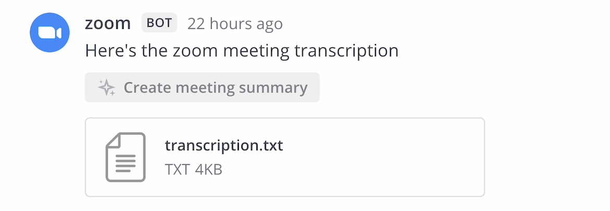
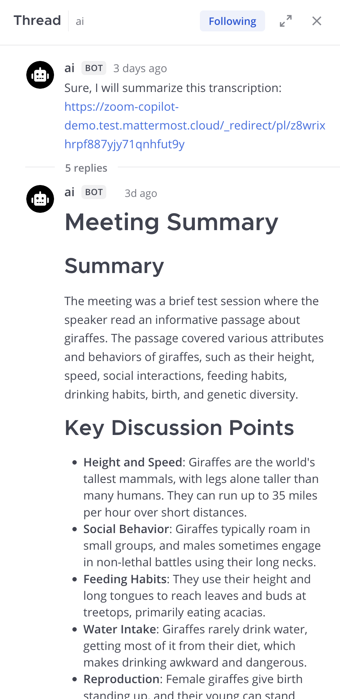

# Meeting summaries

Turn a Mattermost Calls or Zoom transcript into a summary with key points and action items. It's private to you until you post it to the call thread. Needs an Enterprise license.

## Create a summary

1. Record the meeting. For Calls, [start a call and record it](/end-user-guide/collaborate/make-calls) with transcription turned on. For Zoom, see [Zoom prerequisites](#zoom-prerequisites).
2. When the transcript is posted, select **Create meeting summary** on the post.
3. The agent replies in a direct message thread with you: it posts a link to the transcript, then streams the summary. Open the thread in the Agents pane.

The summary has a summary section, key discussion points, and action items if there are any. It doesn't list participants or the date.

While it generates you can select **Stop Generating**, and afterward **Regenerate**. Reply in the thread to ask the agent for changes. To share the summary, select **Post summary**. That posts it to the original call thread, so you need permission to post in that channel. The posted message says the agent created it and you posted it.

## Zoom prerequisites

A System Admin must [enable and configure the Zoom plugin](/integrations-guide/zoom), and Zoom cloud recordings and transcripts must be turned on in Zoom. Then:

1. Subscribe a channel to a recurring Zoom meeting with `/zoom subscription add [meeting ID]`, or start a meeting from the Zoom button in the right-hand sidebar.
2. Record the meeting.
3. When the transcript file is posted to the channel, select **Create meeting summary** on that post.

## How it works

- **Which agent:** the workspace's default agent writes the summary, not the agent you selected in a picker. Your admin sets the default agent.
- **Which transcripts:** only posts from the `calls`, `zoom`, and `google-meet` bot accounts can be summarized. Zoom chat exports and WebVTT transcripts are supported.
- **No tools:** the agent summarizes the transcript text and doesn't call tools.
- **Privacy:** the transcript text is sent to the LLM service the default agent uses. With a self-hosted model, it stays in your environment. See [What agents can see and keep](what_agents_see.md).
- **Who sees it:** the summary stays private to you until you select **Post summary**.

## If the button is missing or the summary fails

A feature or button that's missing or does nothing usually means a license below Enterprise. The Calls or Zoom plugin adds the button, so also check that the plugin is enabled, that the transcript was posted, and that the post comes from the `calls`, `zoom`, or `google-meet` bot. If you get "Sorry! Something went wrong", ask your admin to check the Mattermost Server log. The default agent might be inactive or its LLM service unreachable. If the summary comes from an agent you didn't expect, ask your admin to change the default agent.
