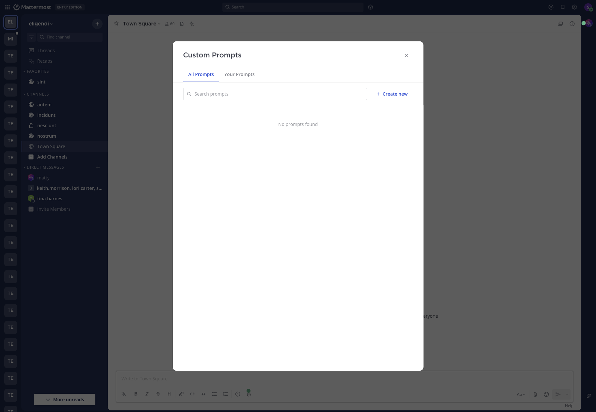

# Skills

Save instructions with variables like `{{.ChannelName}}`, run them from the message composer, share them with your workspace, and let agents load them when a request matches. Personal skills work at every license level, and sharing needs Enterprise.

Skills were called custom prompts before. Existing custom prompts are now skills, and nothing needs migrating.

## Create a skill

1. In any message composer, open **AI Actions** and select **Skills**, then **Manage skills**. You can also open **Skills** in the sidebar of the Agents page.
2. Select **Create new**.
3. Fill in the fields:

   | Field | Notes |
   |---|---|
   | **Action Title** | Required. Up to 64 characters. Appears in menus. |
   | **Brief Description** | Says when the skill applies. Up to 1024 characters. Agents use it to decide whether to load the skill, so a skill without one is only run by hand. |
   | **Instructions** | Required. The text Mattermost sends when you run the skill, or the agent follows when it loads the skill. Write it as you would write a message to the agent. |
   | **Visibility** | **Private** (only you) or **Public** (everyone in the workspace). Private is the default. |

4. Select **Save**.



Use the **Context Variables** button above the **Instructions** field to insert variables. Switching a public skill back to private is always allowed.

## Template variables

Instructions use Go `text/template` syntax. These are the only variables available:

| Variable | Inserts |
|---|---|
| `{{.Username}}` | Your username |
| `{{.FirstName}}` | Your first name |
| `{{.LastName}}` | Your last name |
| `{{.Channel}}` | The current channel's display name |
| `{{.ChannelName}}` | The current channel's name |
| `{{.Team}}` | The current team's display name |
| `{{.TeamName}}` | The current team's name |
| `{{.Time}}` | The current date and time in your time zone, in RFC 1123 format. UTC if your time zone isn't set |
| `{{.BotName}}` | The selected agent's display name |

A variable with no value in the current context, such as `{{.Team}}` in a direct message, renders as empty text.

Variables that include `{{.Channel}}` or `{{.ChannelName}}` tell the agent which channel you're in. They don't pull in the channel's messages. To catch up on a channel, use [Summaries and AI search](summaries_and_search.md).

## Run a skill

Open **AI Actions** in the composer, select **Skills**, choose an agent at the top of the menu if you have several, and select the skill. Mattermost renders the instructions with your current context and puts the result in your draft. If you aren't in a direct message with an agent, it adds the agent's @mention first. Edit the draft if you want, then send it. Files already attached to the draft stay attached.

The agent responds as it would to any message, with the same tool approval and connection prompts. Running a skill this way doesn't change how the agent behaves.

## Let agents load skills

An agent can also load a skill on its own. When a conversation starts, the agent is told the name and description of each skill it may use. When a request matches a description, it loads that skill's instructions and follows them. Only descriptions are sent up front.

What an agent may load is set on the agent's **Skills** tab. See [Skills tab](managing_agents.md#skills-tab).

- **Built-in skills** are always available while the tools they need are, such as the summary instructions the agent uses when it can read channels.
- **Your personal skills** are available in your direct messages with an agent that allows personal skills. They are never used in channels.
- **Shared skills** are available only after they are turned on for that agent.

The skill list is fixed when a conversation starts. If you create or change a skill mid-conversation, tell the agent so it can refresh the list. An agent can't load a skill you no longer have access to.

## Share, pin, and manage skills

In the **Skills** window:

- **All Skills** shows your skills and public skills from others. **Your Skills** shows only yours.
- Search filters by title and description.
- The pin icon pins a skill. Pinned skills are listed first in the composer's **Skills** menu. Pins are personal, and you can pin a public skill someone else wrote.
- A public skill from someone else opens read-only. Only the creator can edit or delete a skill. To change someone else's skill, copy its instructions into a new skill.
- Deleting a skill removes it from everyone's lists and pins, and agents stop loading it.

## Examples

**Incident triage**, title `Triage this channel`:

```text
You are helping me triage an active incident in #{{.ChannelName}} on the {{.Team}} team. As of {{.Time}}, list:

1. The current status in one sentence.
2. The top 3 unresolved questions.
3. Suggested next steps and who is best placed to take them.
```

**Runbook**, title `Run the on-call playbook`:

```text
I'm {{.FirstName}} ({{.Username}}) and I'm on call. Walk me through our "service is degraded" playbook one step at a time. Wait for me to confirm each step. If you need a tool to check service state, ask first.
```

**Code review**, title `Review checklist`:

```text
Apply our review checklist to the diff I paste next: naming, error handling, test coverage of the new behavior, backward-compatibility risk, and anything that belongs in a separate PR. Reply with bullets, not prose.
```

## Limits

- Titles are limited to 64 characters and descriptions to 1024.
- There's no set limit on instructions length, but very long instructions leave less room for the agent's answer.
- The agent is chosen when you run the skill. After the skill is inserted, the @mention is already in your draft, so edit it by hand to change agents.
